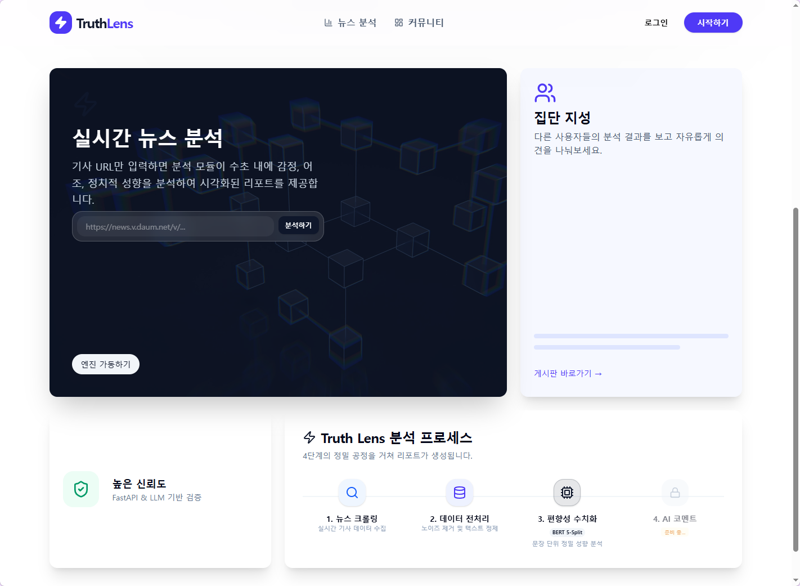
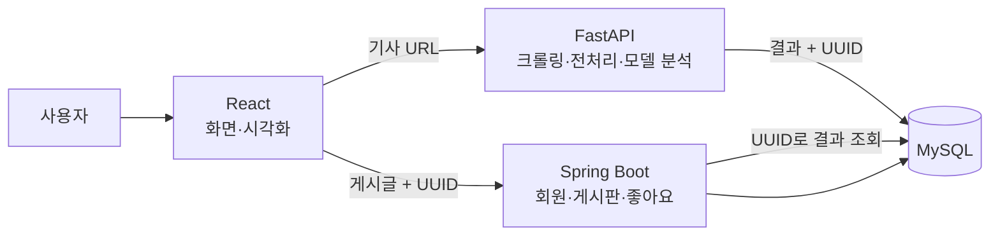
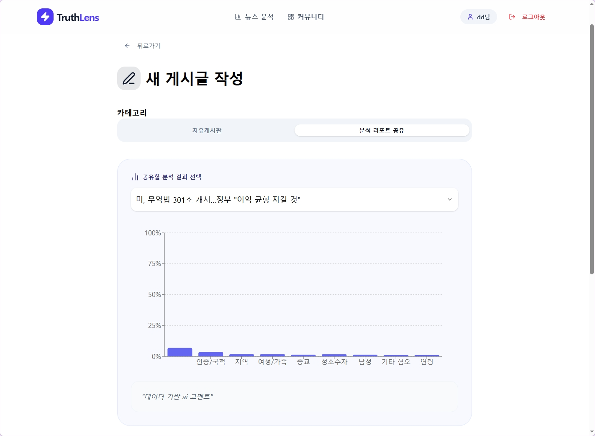
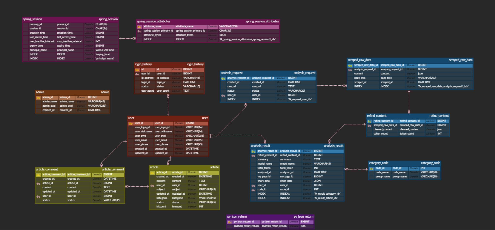
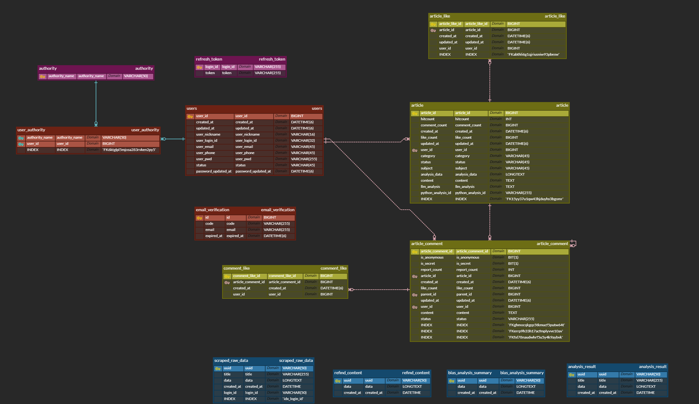
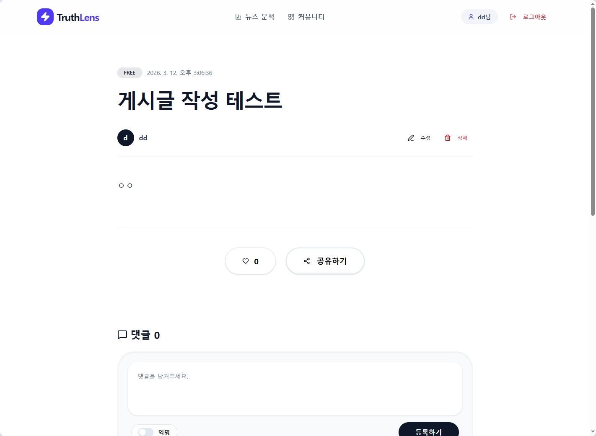
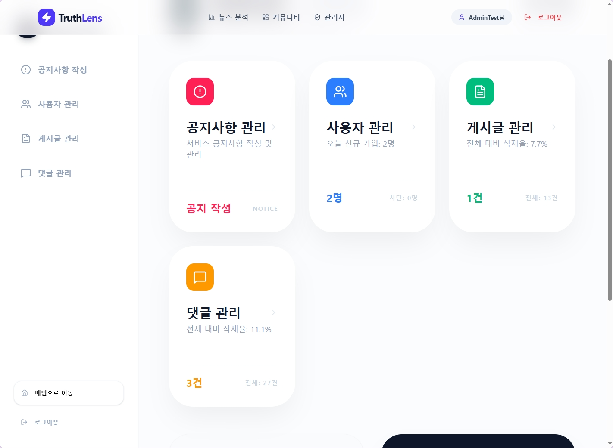

# 편향 한 스푼 (TruthLens)

뉴스 기사의 혐오·편견 표현을 AI 모델로 분석해 시각화하고, 그 결과를 게시글로 공유하며 토론하는 웹 서비스입니다.

- 팀 프로젝트 · MBC아카데미컴퓨터학원 빅데이터 분석 과정 (2026년 3월 발표)
- 팀원: 김유나, 최인호



## 팀과 역할

| 이름 | 담당 |
| --- | --- |
| 김유나 | 커뮤니티 DB 설계(ERD), 게시글·댓글·좋아요 CRUD API (Spring Boot, JPA, MySQL), 분석 결과를 게시글에 연결하는 데이터 구조 |
| 최인호 | 회원·인증(Spring Security, JWT access/refresh 토큰, 이메일 인증), 관리자 기능, 분석 서버(FastAPI 크롤링·모델 분석), React 화면 |

## 동작 흐름

서버 세 개가 JSON으로 통신합니다.



1. **분석:** 사용자가 기사 주소를 넣으면 FastAPI가 크롤링 → 전처리 → 모델 분석을 하고, 단계마다 결과를 UUID와 함께 저장합니다. 단계마다 저장하므로 어느 단계에서 실패했는지 바로 확인할 수 있습니다.
2. **공유:** 사용자가 분석 결과로 게시글을 쓰면 React가 UUID를 Spring에 넘기고, Spring이 그 UUID로 분석 결과(JSON)를 조회해 게시글과 함께 저장합니다.

### 분석 모델

`beomi/kcbert-base`를 스마일게이트 UnSmile 혐오 표현 데이터셋의 10개 범주(여성/가족, 남성, 성소수자, 인종/국적, 연령, 지역, 종교, 기타 혐오, 악플/욕설, clean)로 분류하도록 학습한 모델을 사용합니다. 정치 성향이 아니라 **기사 문장에 담긴 혐오·편견 표현의 비율**을 보여 줍니다.

- 학습된 모델 가중치(`backend-python/saved_model/`)는 용량 때문에 저장소에 포함하지 않았습니다.
- 크롤링은 네이버 뉴스 기사만 지원합니다.
- LLM 코멘트(OpenAI) 기능은 토큰 비용 때문에 비활성화되어 있습니다.



## 내가 맡은 부분: 커뮤니티 설계

### 분석 결과는 외래키 대신 UUID로 받아 게시글에 복사

첫 ERD에서는 분석 테이블을 게시글과 외래키로 연결했지만, 최종 설계에서는 연결을 끊었습니다. 분석 테이블은 Python 서버가 만들고 관리하므로, Spring이 JPA로 묶으면 한쪽 스키마가 바뀔 때 다른 서버까지 영향을 받습니다. 그래서 Spring은 UUID만 받아 `JdbcTemplate`으로 결과를 한 번 조회하고, 게시글을 쓰는 시점의 결과를 게시글에 복사해 저장합니다(`AnalysisDataSyncService`). 결과가 없으면 빈 값과 안내 문구를 넣어 글 작성이 실패하지 않게 했습니다.

- 장점: 두 서버가 서로의 테이블 구조에 묶이지 않음
- 단점: 데이터가 중복되고, 원본 분석이 바뀌어도 게시글에는 반영되지 않음

### 좋아요: 기록 테이블 + 개수 컬럼

- **누가 눌렀는지**는 `article_like`, `comment_like` 테이블에 저장합니다. 중복 좋아요를 막고 "내가 눌렀는지"를 보여 주는 데 씁니다.
- **개수**는 게시글·댓글의 `like_count` 컬럼에 따로 둡니다. 목록을 보여 줄 때마다 글마다 `COUNT`를 실행하지 않기 위한 반정규화입니다.
- 개수 증가는 엔티티 값을 읽어 +1 하지 않고 `UPDATE ... SET like_count = like_count + 1` 쿼리로 DB가 직접 처리합니다. 동시에 여러 명이 눌러도 값이 덮어쓰이지 않습니다.
- 그래도 기록과 개수가 어긋날 수 있어서, 매일 정오에 배치(`CountBatchScheduler`)가 실제 개수를 세어 다르면 맞춥니다.
- 게시글 좋아요와 댓글 좋아요는 패키지를 나눠, 한쪽을 고쳐도 다른 쪽에 영향이 없게 했습니다.

### 그 밖의 설계

- **소프트 삭제:** 게시글·댓글을 실제로 지우지 않고 `status`를 `DELETED`로 바꿉니다. 댓글과 좋아요 기록을 보존하고, 관리자가 확인하거나 복구할 수 있습니다.
- **권한:** 수정·삭제는 작성자 본인 또는 관리자만 할 수 있고, 아니면 403을 돌려줍니다.
- **대댓글:** 댓글이 `parent_id`로 자기 자신을 참조합니다. 익명·비밀 댓글 여부와 신고 수도 댓글에 둡니다.
- **N+1 방지:** 목록에서 작성자를 함께 보여 줄 때 검색 쿼리는 `JOIN FETCH`, 내가 쓴 글 목록은 `@EntityGraph`로 한 번에 가져옵니다.

## ERD 변화

| 첫 설계 | 최종 설계 |
| --- | --- |
|  |  |

- 세션 방식 → JWT 방식으로 바꾸며 세션·로그인 기록·별도 관리자 테이블을 없애고, refresh 토큰·권한 테이블을 추가
- 이메일 인증 테이블, 게시글·댓글 좋아요 테이블 추가
- 분석 자료와 게시글 사이의 외래키 제거 (위 설명 참고)

## 기술 스택

| 구분 | 기술 |
| --- | --- |
| Frontend | React (Vite), Recharts, Tailwind CSS |
| Backend (분석) | FastAPI, BeautifulSoup, Hugging Face Transformers |
| Backend (커뮤니티) | Spring Boot 3, Spring Security, JWT, JPA, JavaMailSender |
| Database | MySQL |

## 한계와 개선할 점

- **좋아요 중복 가능성:** "이미 눌렀는지 확인 → 저장" 순서라서, 같은 사람의 요청 두 개가 동시에 확인을 통과하면 중복 저장될 수 있습니다. `(article_id, user_id)` 유니크 제약을 걸고 제약 위반을 409로 바꾸는 것이 맞습니다.
- **상태값이 문자열:** `ACTIVE`, `DELETED`가 문자열이라 오타를 컴파일 시점에 잡지 못합니다. Enum으로 바꿀 계획이었습니다.
- **배치 성능:** 개수 보정 배치가 전체 게시글을 불러와 하나씩 세므로, 데이터가 많아지면 페이징이나 `GROUP BY` 한 번으로 바꿔야 합니다.
- **테스트 부족:** 테스트가 댓글 서비스 하나뿐이라, 좋아요 중복·권한 같은 핵심 규칙을 테스트로 고정하지 못했습니다.

## 실행 방법

MySQL에 `bias_analysisdb` 데이터베이스를 만들고, 아래 환경 변수를 설정한 뒤 세 서버를 실행합니다.

| 환경 변수 | 사용처 | 설명 |
| --- | --- | --- |
| `DB_USERNAME`, `DB_PASSWORD` | Spring, FastAPI | MySQL 계정 |
| `DB_HOST` | FastAPI | MySQL 주소 (기본값 localhost) |
| `JWT_SECRET` | Spring | JWT 서명 키 (충분히 긴 임의 문자열) |
| `MAIL_USERNAME`, `MAIL_PASSWORD` | Spring | 이메일 인증용 Gmail 계정과 앱 비밀번호 |
| `OPENAI_API_KEY` | FastAPI | LLM 코멘트용 (현재 비활성화) |

```bash
# 1. 커뮤니티 서버 (포트 8080)
cd backend-java/bias_analysis
./gradlew bootRun

# 2. 분석 서버 (포트 8000) — 학습된 모델을 backend-python/saved_model/ 에 넣어야 함
cd backend-python
python -m venv venv
venv\Scripts\activate
uvicorn main:app --reload --port 8000

# 3. 화면 (포트 5173)
cd frontend-js
npm install
npm run dev
```

## 화면

| 게시글 상세 | 관리자 대시보드 |
| --- | --- |
|  |  |

나머지 화면은 [docs/screenshots](docs/screenshots), 발표 자료는 [docs/presentation.pdf](docs/presentation.pdf)에 있습니다.
